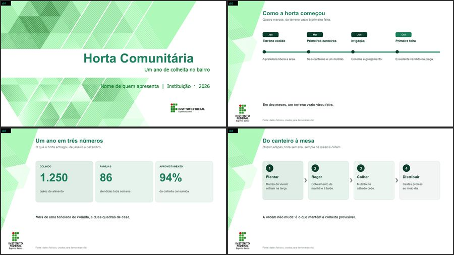
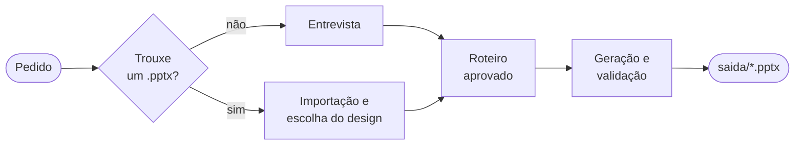
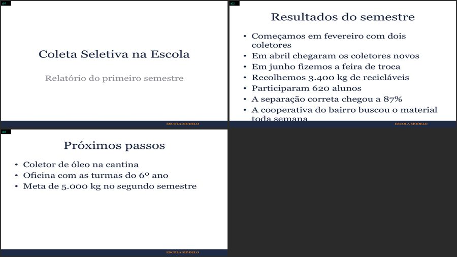
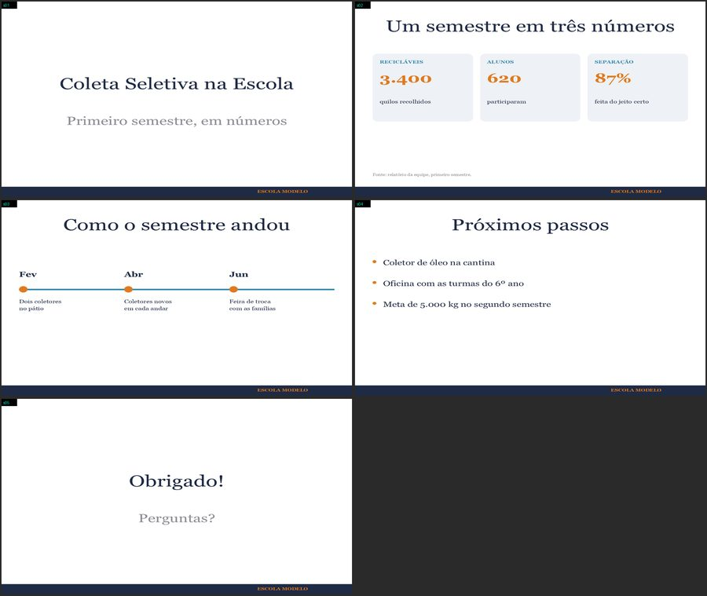

# slidecraft

[](https://github.com/Leonardo-Baptista/slidecraft/actions/workflows/testes.yml)


[](LICENSE)

**Apresentações PowerPoint padronizadas, feitas por um agente de IA dentro do
seu editor.**

Você abre este repositório no VS Code, Cursor, Antigravity ou outro editor com
agente (Claude Code, Codex, Gemini, Copilot), descreve a apresentação ou
entrega uma que já tem, e o agente prepara o Python, pergunta o que falta,
mostra o roteiro, monta os slides em código, confere e entrega um `.pptx`
editável.

A ideia é dar a uma apresentação, nova ou existente, estrutura melhor e uma
roupagem moderna (transições, entradas animadas, números que sobem, linha do
tempo que se desenha, GIFs e vídeos) **sem a cara evidente de slide feito por
IA**.

<p align="center">
  
</p>

---

## O que o kit entrega

| Recurso | Como aparece |
|---|---|
| **Transição** | fade por preto em todos os slides; Morph entre slides de mesma estrutura |
| **Entrada animada** | automática, sem clique, só `fade` e `wipe`, na ordem do conteúdo |
| **Números que sobem** | o número estratégico conta de zero até o valor; parado ou em PDF, mostra o valor final |
| **Linha do tempo** | a barra preenche da esquerda para a direita e cada marco aparece quando ela passa |
| **Cartões e fluxos** | etapas numeradas que entram em cascata |
| **Imagens, GIFs e vídeos** | imagem em moldura sem deformar, GIF gerado em Python, vídeo curto em loop |
| **Notas do apresentador** | o roteiro de fala dentro de cada slide |
| **Reformulação** | uma apresentação existente ganha estrutura e movimento, mantendo ou trocando o design |
| **Validação** | paleta, fonte, margem, colisão de texto, corpo mínimo, barras e transição, conferidos por script |

---

## Sem cara de slide feito por IA

Material gerado por IA costuma se denunciar pelos mesmos vícios. Aqui eles são
evitados por regra, e os principais são cobrados por código:

| Vício comum | O que acontece aqui |
|---|---|
| **Travessão**, muitas vezes vários por slide | proibido em slide, notas, código e documentação; a geração recusa |
| **Barra vertical ao lado do texto**, filete sobre título, faixa lateral em caixa | **regra de ouro**: nenhuma barra; o validador reprova |
| **Lista longa de marcadores** | no máximo quatro; o resto vira outro slide |
| **Título de efeito** | o título diz o fato do slide |
| **Emoji e ícone genérico** decorando | fora; ícone só quando informa |
| **Animação que voa e gira** | só `fade` e `wipe`, de entrada, onde há ordem |
| **Número sem procedência** | linha de fonte em todo slide com dado |

A hierarquia se faz com negrito, corpo e espaço. A lista completa, com o
motivo de cada regra, está em
[docs/padrao-visual.md](docs/padrao-visual.md#4c-sem-cara-de-slide-feito-por-ia).

---

## Começo rápido

1. Clone e abra a pasta no seu editor:
   ```
   git clone https://github.com/Leonardo-Baptista/slidecraft.git
   ```
2. No chat do agente, peça:
   > Crie uma apresentação sobre reciclagem para o ensino médio, 15 minutos.
   > Siga o AGENTS.md.

   ou

   > Reformule `C:\aulas\minha_aula.pptx` no padrão deste repositório. Siga o
   > AGENTS.md.
3. Responda às perguntas, aprove o roteiro e abra o arquivo em `saida/`.
   Apresente com F5 para ver as animações.

O agente cria o ambiente virtual `.venv` e instala as dependências sozinho;
você só precisa ter o Python. [AGENTS.md](AGENTS.md) é lido pelo Codex, Cursor
e Antigravity, e [CLAUDE.md](CLAUDE.md), [GEMINI.md](GEMINI.md) e
[.github/copilot-instructions.md](.github/copilot-instructions.md) apontam
para ele.

---

## Como funciona



**Criar do zero.** O agente pergunta, numa mensagem só e sugerindo um padrão
para cada item: tema e objetivo, público e duração, quantidade de slides,
capa, identidade visual, imagens e vídeos (e onde estão), números que devem
subir, GIFs em Python e notas do apresentador. Depois mostra o roteiro, slide
a slide, e só gera com o seu "ok".

**Reformular uma apresentação existente.** O agente roda
`scripts/importar_pptx.py`, que extrai texto, imagens, vídeos, tabelas,
gráficos, notas e o design do arquivo (cores realmente usadas, fontes, fundos
e margens, mesmo quando tudo foi desenhado à mão). A primeira pergunta é
sempre: **manter o design do original ou passar para o padrão do
repositório?** Depois vem o roteiro de-para (de qual slide original vem cada
slide novo), e nada é cortado sem aprovação.

<table>
  <tr>
    <td align="center"><br><sub>Antes: três slides de lista</sub></td>
    <td align="center"><br><sub>Depois: o mesmo design, com estrutura e movimento</sub></td>
  </tr>
</table>

---

## Identidades visuais

| | `ifes` (padrão) | `escuro` | `importada` |
|---|---|---|---|
| Para quê | aulas, seminários, institucional | palestra com foto em tela cheia | manter o visual de um arquivo existente |
| Fundo | modelo do IFES | preto ou branco, sólido | o do original |
| Cores | três verdes do modelo | preto, branco e turquesa | as do original |
| Fonte | Arial | Montserrat | a do original |
| Formato | 16:9 | 16:9 | o do original |

Transição, animação, número que sobe, linha do tempo, regras de escrita e a
proibição de barras valem para as três.

---

## Que movimento usar

| O slide mostra | Movimento |
|---|---|
| capa ou encerramento | quase parado, cascata curta no texto |
| número estratégico | número que sobe, no máximo três por slide |
| datas em sequência | linha do tempo com barra e marcos |
| etapas de processo | cartões em cascata, da esquerda para a direita |
| lista de argumentos | um item por vez |
| a mesma estrutura do slide anterior | Morph |
| vídeo | o vídeo não anima; o texto ao redor entra |

Animar estrutura, nunca decoração. E a ordem de montagem importa: formas,
depois animação, depois vídeo, depois transição. Vídeo inserido antes da
animação não toca (detalhes em [docs/armadilhas.md](docs/armadilhas.md)).

---

## Onde fica cada coisa

```
slidecraft/
├── AGENTS.md            roteiro do agente
├── kit/                 o sistema visual: temas, composições, animação,
│                        transição, números, importação, medição de texto
├── decks/
│   ├── _modelo/             ponto de partida de todo deck novo (IFES)
│   ├── exemplo/             um slide de cada recurso, tema fictício
│   ├── exemplo_importado/   apresentação simples reformulada, design mantido
│   └── demonstracao/        catálogo da identidade escuro
├── scripts/             novo_deck, importar_pptx, produzir, validar_deck,
│                        exportar_slides, verificar_texto
├── docs/                padrão visual, armadilhas, validação
├── testes/              a suíte do kit
└── saida/               os .pptx gerados (fora do Git)
```

Cada apresentação é uma pasta em `decks/`, com `assets/` para imagens, GIFs e
vídeos (fora do Git), `build.py` com uma função por slide e, se precisar,
`gera_ativos.py` para GIFs e clipes gerados em Python.

---

## Sem agente, na mão

```
python -m venv .venv
.venv\Scripts\python.exe -m pip install -r requirements.txt     (Windows)
.venv/bin/python -m pip install -r requirements.txt             (macOS e Linux)

python scripts/novo_deck.py minha_palestra
python scripts/produzir.py minha_palestra
```

Use o Python do `.venv`. Edite `decks/minha_palestra/build.py` copiando os
slides de `decks/exemplo/build.py`. O `produzir.py` gera, valida e exporta a
folha de contato (`saida/_slides_nome/contato.png`), que é para olhar antes
de apresentar. O que o validador cobra está em
[docs/validacao.md](docs/validacao.md).

---

## Requisitos

| | |
|---|---|
| **Python** | 3.10 ou mais novo. O ffmpeg vem dentro do `.venv`. |
| **PowerPoint** | Windows ou macOS, para apresentar. Morph pede 2019 ou 365. LibreOffice, Keynote e Google Slides abrem o arquivo, mas perdem parte das animações e dos vídeos. |
| **Fontes** | Arial para o IFES; Montserrat (gratuita, Google Fonts) para o escuro. |
| **Folha de contato** | Só no Windows com PowerPoint; nos outros sistemas, a conferência é abrindo o arquivo. |

---

## Como contribuir

A `main` é protegida: toda mudança entra por pull request e precisa da
aprovação do mantenedor.

1. Faça um fork e crie uma branch a partir da `main`.
2. Faça a mudança, com teste se mexer no `kit/`.
3. Abra o pull request; os testes rodam sozinhos no GitHub.
4. O mantenedor revisa e aprova, pede ajustes ou recusa.

O passo a passo e as convenções estão em [CONTRIBUTING.md](CONTRIBUTING.md).

---

## Autor e licença

Criado e mantido por **Leonardo Baptista**.

Código sob a licença MIT, em [LICENSE](LICENSE). Os fundos em
`kit/assets/ifes/` reproduzem o modelo institucional de apresentação do
Instituto Federal do Espírito Santo, de uso público; a marca do IFES pertence
à instituição.
