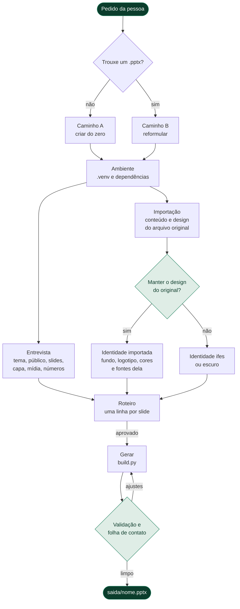
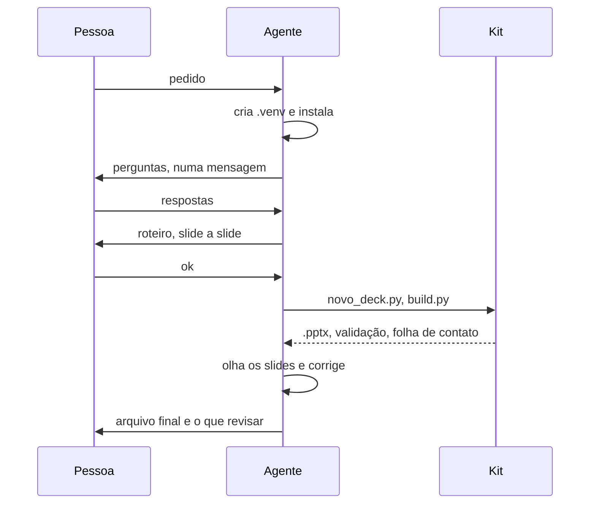
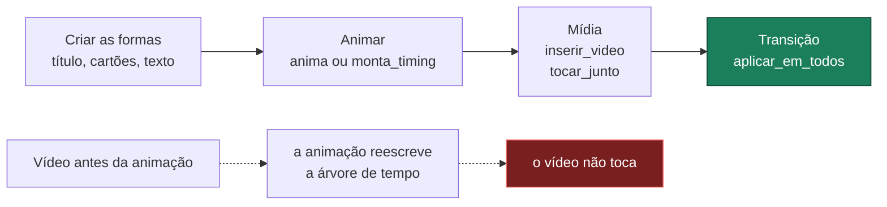
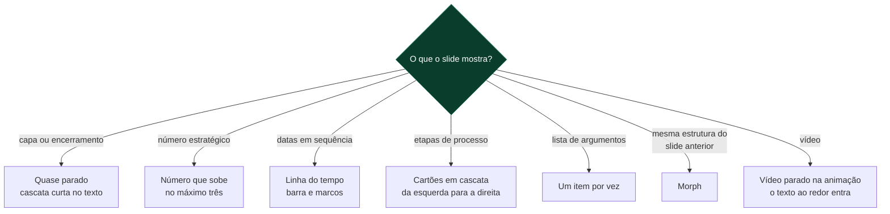
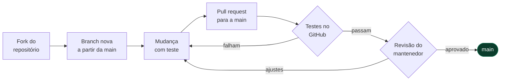

# slidecraft

[](https://github.com/Leonardo-Baptista/slidecraft/actions/workflows/testes.yml)


[](LICENSE)

**Apresentações PowerPoint padronizadas, feitas por um agente de IA dentro do
seu editor.**

Você abre este repositório no VS Code, Cursor, Antigravity ou outro editor com
agente (Claude Code, Codex, Gemini, Copilot), descreve a apresentação, ou
entrega uma que já tem, e o agente faz o resto: prepara o Python, pergunta o
que falta, mostra o roteiro, monta os slides em código, confere e entrega um
`.pptx` editável.

O padrão não fica na cabeça de quem diagrama: fica em código. Paleta,
tipografia, posição de cada bloco, animação de entrada e transição já estão
resolvidas no kit, e um validador confere tudo antes da entrega.

A ideia é dar a uma apresentação, nova ou já existente, uma estrutura melhor
e uma roupagem moderna (transições, entradas animadas, números que sobem,
linha do tempo que se desenha, GIFs e vídeos) **sem a cara evidente de slide
feito por IA**.


*O deck de exemplo, num tema fictício: capa, linha do tempo, números que
sobem, fluxo em cartões, imagem, GIF, vídeo, Morph e encerramento.*

---

## Sumário

1. [O que o kit entrega](#o-que-o-kit-entrega)
2. [Sem cara de slide feito por IA](#sem-cara-de-slide-feito-por-ia)
3. [Começo rápido](#começo-rápido)
4. [Os dois caminhos](#os-dois-caminhos)
5. [Criar do zero](#criar-do-zero)
6. [Reformular uma apresentação existente](#reformular-uma-apresentação-existente)
7. [Identidades visuais](#identidades-visuais)
8. [Como o movimento funciona](#como-o-movimento-funciona)
9. [Onde fica cada coisa](#onde-fica-cada-coisa)
10. [Sem agente, na mão](#sem-agente-na-mão)
11. [Validação](#validação)
12. [Requisitos](#requisitos)
13. [Como contribuir](#como-contribuir)
14. [Autor e licença](#autor-e-licença)

---

## O que o kit entrega

| Recurso | Como aparece na apresentação |
|---|---|
| **Transição** | fade por preto em todos os slides; Morph entre slides de mesma estrutura |
| **Entrada animada** | automática, sem clique, só `fade` e `wipe`, na ordem do conteúdo |
| **Números que sobem** | o número estratégico entra contando de zero até o valor; parado ou em PDF, mostra o valor final |
| **Linha do tempo** | a barra preenche da esquerda para a direita e cada marco aparece quando ela passa |
| **Cartões e fluxos** | etapas numeradas que entram em cascata, com seta entre elas |
| **Imagens** | encaixadas em moldura, sem deformar |
| **GIFs gerados em Python** | gráficos e processos animados, desenhados com Pillow |
| **Vídeo** | clipe curto, sem áudio, tocando sozinho em loop |
| **Notas do apresentador** | o roteiro de fala dentro de cada slide |
| **Reformulação** | uma apresentação existente ganha estrutura e movimento, mantendo ou trocando o design |
| **Validação** | paleta, fonte, margem, colisão de texto, corpo mínimo e transição, conferidos por script |
| **Escrita** | português do Brasil, acentuação conferida, nenhum travessão |

---

## Sem cara de slide feito por IA

Material gerado por IA costuma se denunciar pelos mesmos vícios. Este
repositório evita cada um deles, e vários são cobrados por código, não por
boa vontade:

| Vício comum | O que acontece aqui |
|---|---|
| **Travessão** (e o uso excessivo dele, vários por slide) | proibido em slide, notas, código e documentação; a geração recusa e o validador acusa |
| **Barra ou filete sobre o título** | nenhuma composição desenha; o título fica sozinho |
| **Caixa tingida com faixa lateral colorida** em todo slide | substituída por uma régua fina e a frase de fecho |
| **Lista longa de marcadores** | no máximo quatro; o resto vira outro slide |
| **Título de efeito** | o título diz o fato do slide |
| **Emoji e ícone genérico** decorando | fora; ícone só quando informa |
| **Animação que voa e gira** | só `fade` e `wipe`, de entrada, onde há ordem |
| **Número sem procedência** | linha de fonte em todo slide com dado |

A lista completa, com o motivo de cada regra, está em
[docs/padrao-visual.md](docs/padrao-visual.md#4c-sem-cara-de-slide-feito-por-ia).

---

## Começo rápido

1. Clone e abra a pasta no seu editor:
   ```
   git clone https://github.com/Leonardo-Baptista/slidecraft.git
   ```
2. No chat do agente, peça. Dois exemplos:
   > Crie uma apresentação sobre reciclagem de plástico para alunos do ensino
   > médio, 15 minutos. Siga o AGENTS.md.

   > Reformule a apresentação `C:\aulas\minha_aula.pptx` no padrão deste
   > repositório. Siga o AGENTS.md.
3. Responda às perguntas, aprove o roteiro e abra o arquivo que sai em
   `saida/`. Apresente com F5 para ver as animações.

Você não precisa instalar nada além do Python: o agente cria o ambiente
virtual `.venv` e instala as dependências sozinho. Os agentes encontram o
roteiro sem você apontar: [AGENTS.md](AGENTS.md) é lido pelo Codex, Cursor e
Antigravity; [CLAUDE.md](CLAUDE.md), [GEMINI.md](GEMINI.md) e
[.github/copilot-instructions.md](.github/copilot-instructions.md) apontam
para ele.

---

## Os dois caminhos



O agente nunca gera sem antes mostrar o roteiro, e nunca decide sozinho se o
design de uma apresentação importada muda.

---

## Criar do zero

O agente faz as perguntas numa mensagem só, sugerindo um padrão para cada
uma, para você poder responder só "ok":

| # | Pergunta | Padrão sugerido |
|---|---|---|
| 1 | Tema e objetivo | |
| 2 | Público e duração | |
| 3 | Quantidade de slides | um a cada minuto e meio |
| 4 | Capa: título, subtítulo, assinatura | |
| 5 | Identidade visual | `ifes` |
| 6 | Imagens: quais, onde estão, em que slide | |
| 7 | Vídeos | 15 a 25 s, sem áudio, em loop |
| 8 | Números estratégicos que entram contando | nenhum |
| 9 | GIFs gerados em Python | nenhum |
| 10 | Material de apoio | |
| 11 | Notas do apresentador | sim |

Depois vem o roteiro, e só então a geração.



---

## Reformular uma apresentação existente

```
python scripts/importar_pptx.py caminho/da/apresentacao.pptx nome_do_deck
```

O script copia o arquivo para `decks/nome_do_deck/assets/original.pptx` e
extrai para `assets/importado/`:

| Arquivo | O que tem |
|---|---|
| `conteudo.json` | título, textos, tabelas, dados dos gráficos, imagens, vídeos, fundo e notas de cada slide |
| `design.json` | cores do tema e cores realmente usadas, fontes, fundo de cada slide, margens, tamanho e layouts |
| `sNN_imagem*.png`, `sNN_*.mp4` | as imagens e os vídeos de cada slide |

O título é reconhecido mesmo quando foi desenhado numa caixa de texto comum,
e a paleta sai do que os slides usam, não só do tema: muita apresentação é
desenhada à mão sobre o tema padrão do Office.

A primeira pergunta é sempre esta: **manter o design do original ou passar
para o padrão do repositório?**

- **Manter** (identidade `importada`): o deck novo é montado sobre o próprio
  arquivo. Mestre, layouts, fundos, logotipo, cores, fontes e formato
  continuam; entram a estrutura e o movimento do kit. O validador passa a
  cobrar a paleta e as margens do original.
- **Trocar**: o conteúdo extraído é remontado no modelo IFES ou no escuro.

Em seguida o agente mostra o roteiro **de-para** (de qual slide original vem
cada slide novo). Slide denso vira dois ou três, lista de números vira
cartões que sobem, sequência de datas vira linha do tempo. Nada é cortado sem
aprovação.

| Antes: três slides de lista | Depois: o mesmo design, com estrutura e movimento |
|---|---|
|  |  |

*O exemplo em `decks/exemplo_importado`. Faixa, marca, cores, fonte Georgia e
formato 4:3 continuam os do original.*

---

## Identidades visuais

| | `ifes` (padrão) | `escuro` | `importada` |
|---|---|---|---|
| Para quê | aulas, seminários, material institucional | palestra com foto em tela cheia | manter o visual de quem trouxe o arquivo |
| Fundo | modelo do IFES, com faixa verde e logotipo | preto ou branco, sólido | o do arquivo original |
| Cores | três verdes do modelo | preto, branco e turquesa `#00E5C0` | tema e cores usadas no original |
| Fonte | Arial (Tahoma na capa) | Montserrat | a do original |
| Formato | 16:9 | 16:9 | o do original |
| Módulos | `tema_ifes.py`, `layouts_ifes.py` | `tema.py`, `layouts.py` | `importado.py` |

O que **não** muda entre elas: a transição, o vocabulário de animação, o
número que sobe, a linha do tempo, a medição de texto, as regras de escrita e
a exigência de fonte nos dados.

---

## Como o movimento funciona

Cada slide segue a mesma ordem de montagem. A ordem importa: a animação é
escrita direto no XML do PowerPoint, e escrevê-la apaga o que estiver lá.



Que animação usar em cada tipo de conteúdo:



Animar estrutura, nunca decoração: onde a animação não significa nada, ela só
atrasa a leitura.

---

## Onde fica cada coisa

```
slidecraft/
├── AGENTS.md              roteiro do agente: ambiente, perguntas, geração, regras
├── kit/                   o sistema visual (não muda de deck para deck)
│   ├── tema_ifes.py           paleta, fontes e grade do modelo IFES
│   ├── layouts_ifes.py        cabeçalho, cartão, chip, destaque, fonte, imagem,
│   │                          linha do tempo e cartões de número
│   ├── layouts.py             sete composições prontas da identidade escuro
│   ├── importado.py           extrai um .pptx e reaproveita o design dele
│   ├── numeros.py             número que sobe de zero até o valor
│   ├── animacao.py            animação de entrada, escrita no XML
│   ├── coreografia.py         grupos de animação e barra de progresso
│   ├── transicoes.py          fade por preto e Morph
│   ├── slides.py              vídeo com início automático e loop
│   ├── clipes.py              corte de vídeo, clipes em código, busca de fonte
│   ├── medidas.py             mede o texto antes de desenhar
│   └── editorial.py           acentuação, travessão e notas
├── decks/
│   ├── _modelo/               ponto de partida de todo deck novo (IFES)
│   ├── exemplo/               um slide de cada recurso, tema fictício
│   ├── exemplo_importado/     apresentação simples reformulada, design mantido
│   └── demonstracao/          catálogo da identidade escuro
├── scripts/
│   ├── novo_deck.py           cria decks/<nome> a partir do modelo
│   ├── importar_pptx.py       prepara a reformulação de um .pptx existente
│   ├── produzir.py            gera, valida e exporta a folha de contato
│   ├── validar_deck.py        confere se o .pptx está no padrão
│   ├── exportar_slides.py     slides em PNG (Windows com PowerPoint)
│   └── verificar_texto.py     regras de escrita no repositório inteiro
├── docs/                  padrão visual, armadilhas conhecidas, validação
├── testes/                a suíte do kit
└── saida/                 os .pptx gerados (fora do Git)
```

Cada apresentação é uma pasta em `decks/`:

```
decks/minha_palestra/
├── assets/          suas imagens, GIFs e vídeos (fora do Git)
├── gera_ativos.py   opcional: GIFs e clipes gerados em Python
└── build.py         os slides, uma função por slide
```

---

## Sem agente, na mão

Use o Python do `.venv` (`.venv\Scripts\python.exe` no Windows,
`.venv/bin/python` no macOS e Linux):

```
python -m venv .venv
python -m pip install -r requirements.txt
python scripts/novo_deck.py minha_palestra
```

Ponha as imagens em `decks/minha_palestra/assets/`, edite
`decks/minha_palestra/build.py` copiando os slides de
`decks/exemplo/build.py` e rode:

```
python scripts/produzir.py minha_palestra
```

Um slide típico no modelo IFES:

```python
def s03_numeros(prs):
    s = novo(prs)
    t, sub = cabecalho(s, "Um ano em três números",
                       "O que a horta entregou de janeiro a dezembro.")
    grupos, filmes = cartoes_de_numeros(
        s, [("Colhido", 1250, inteiro, "quilos de alimento"),
            ("Famílias", 86, inteiro, "atendidas toda semana"),
            ("Aproveitamento", 94, porcentagem(), "da colheita consumida")],
        AQUI / "video")
    faixa = destaque(s, 5.0, "Mais de uma tonelada de comida.")
    fonte(s, "Fonte: dados fictícios.")
    anima(s, [(0, [t]), (240, [sub])] + grupos + [(2200, list(faixa))])
    tocar_junto(s, filmes)          # sempre depois do anima
```

---

## Validação

`scripts/produzir.py` gera os ativos, gera o arquivo, valida e exporta a
folha de contato, num comando só. Código de saída 0 quando tudo está limpo,
1 com aviso, 2 com erro.

| O validador cobra | Erro ou aviso |
|---|---|
| Cor ou fonte fora da identidade | erro |
| Slide sem transição, ou transição fora de fade e Morph | erro |
| Travessão no texto | erro |
| Texto de exemplo do modelo esquecido no slide | erro |
| Forma além da margem | aviso |
| Texto sobre texto, medido pela fonte real | aviso |
| Corpo abaixo do mínimo do perfil (`ao_vivo` 12, `leitura` 11) | aviso |

A folha de contato (`saida/_slides_nome/contato.png`) é para olhar: colisão,
foto mal enquadrada e slide vazio só aparecem quando alguém vê. Detalhes em
[docs/validacao.md](docs/validacao.md).

---

## Requisitos

| | |
|---|---|
| **Python** | 3.10 ou mais novo. O ffmpeg vem dentro do `.venv`, pelo `imageio-ffmpeg`. |
| **PowerPoint** | Windows ou macOS, para apresentar. Morph pede 2019 ou 365; nas versões antigas, vira fade. LibreOffice, Keynote e Google Slides abrem o arquivo, mas perdem parte das animações e dos vídeos. |
| **Fontes** | Arial, que já vem no sistema, para o IFES. Montserrat (gratuita, Google Fonts) para a identidade escuro. |
| **Folha de contato** | A exportação em imagem usa a automação do PowerPoint e só roda no Windows. Nos outros sistemas, o resto funciona e a conferência é abrindo o arquivo. |

Para mexer no kit:

```
python -m pip install -r requirements-dev.txt
python -m pytest testes -q
```

Mais leitura: [docs/padrao-visual.md](docs/padrao-visual.md) (o padrão e o
porquê de cada regra) e [docs/armadilhas.md](docs/armadilhas.md) (problemas
conhecidos e a solução de cada um).

---

## Como contribuir

Contribuições são bem-vindas. A `main` é protegida: ninguém envia direto para
ela. Toda mudança entra por pull request, e quem aprova é o mantenedor.



O passo a passo está em [CONTRIBUTING.md](CONTRIBUTING.md).

---

## Autor e licença

Criado e mantido por **Leonardo Baptista**.

Código sob a licença MIT, em [LICENSE](LICENSE). Os fundos em
`kit/assets/ifes/` reproduzem o modelo institucional de apresentação do
Instituto Federal do Espírito Santo, de uso público; a marca do IFES pertence
à instituição.
